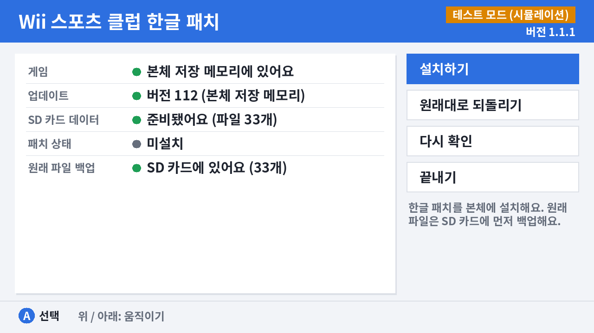

# Wii 스포츠 클럽 한글 패치

일본판 AWSJ01, 업데이트 버전 112을 위한 팬 한글 패치입니다.

## 설치

[릴리스 다운로드](../../releases/latest)에서 Wii U용 또는 Cemu용 ZIP을 받아 압축을 풀고, 안에 있는 `설치 안내.txt`를 따라 주세요. Wii U용은 Aroma와 SD 카드가 필요합니다.

게임 실행 시 패키지에 포함된 SD 카드와 Aroma가 필요합니다. 게임 전용 글꼴 구성 요소는 실기기에서 아직 검증되지 않았습니다.

## 구성과 출처

번역 및 설치 도구, 각 구성 요소의 소스와 라이선스 고지는 배포 ZIP에 포함되어 있습니다. 게임 원본과 업데이트는 별도로 필요합니다.
