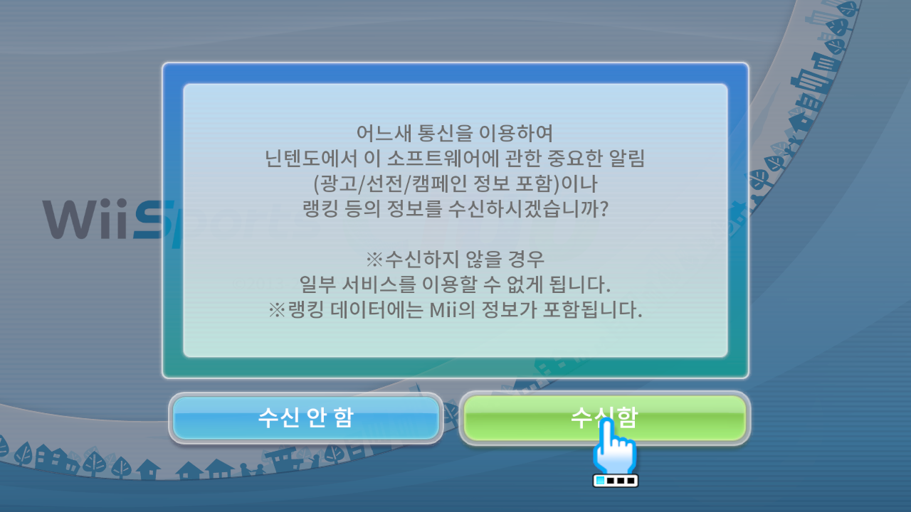
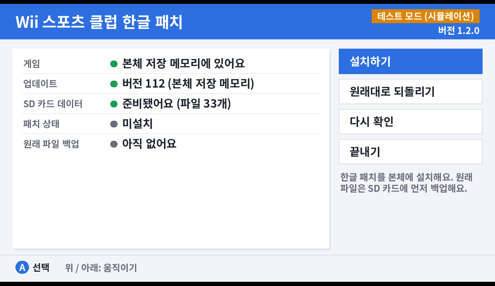
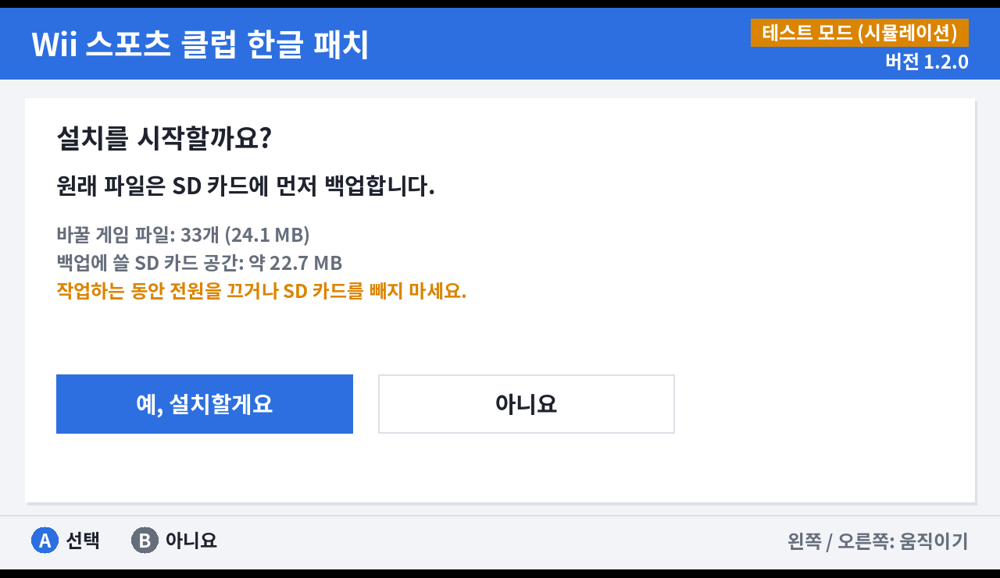
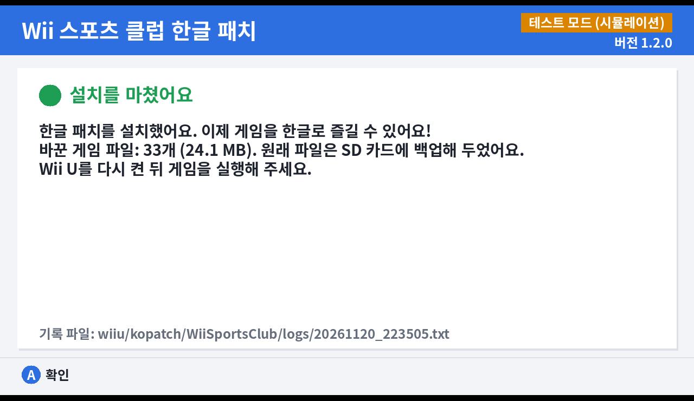
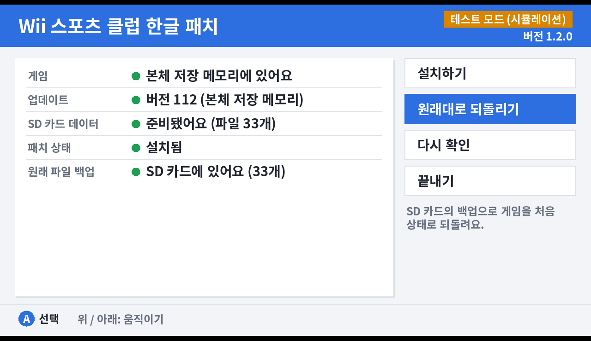
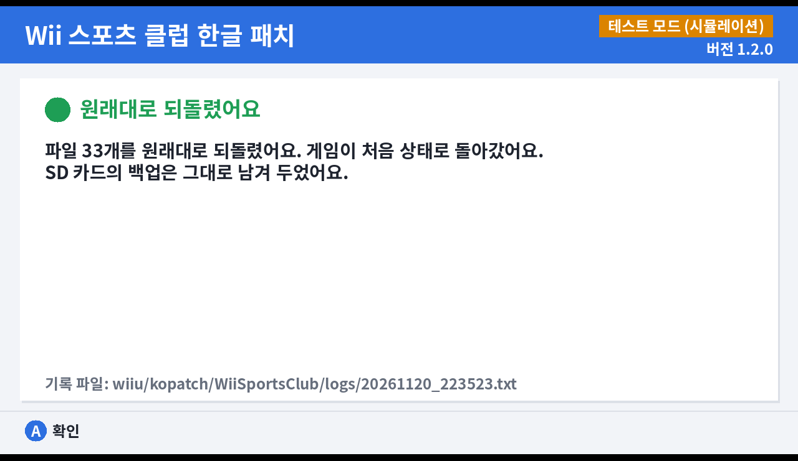
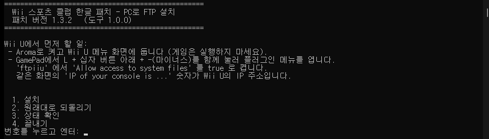
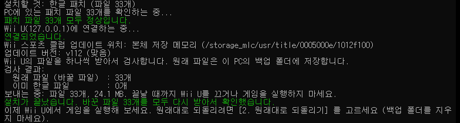
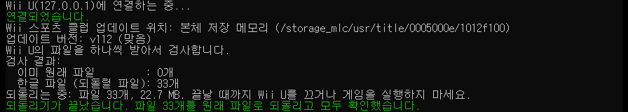
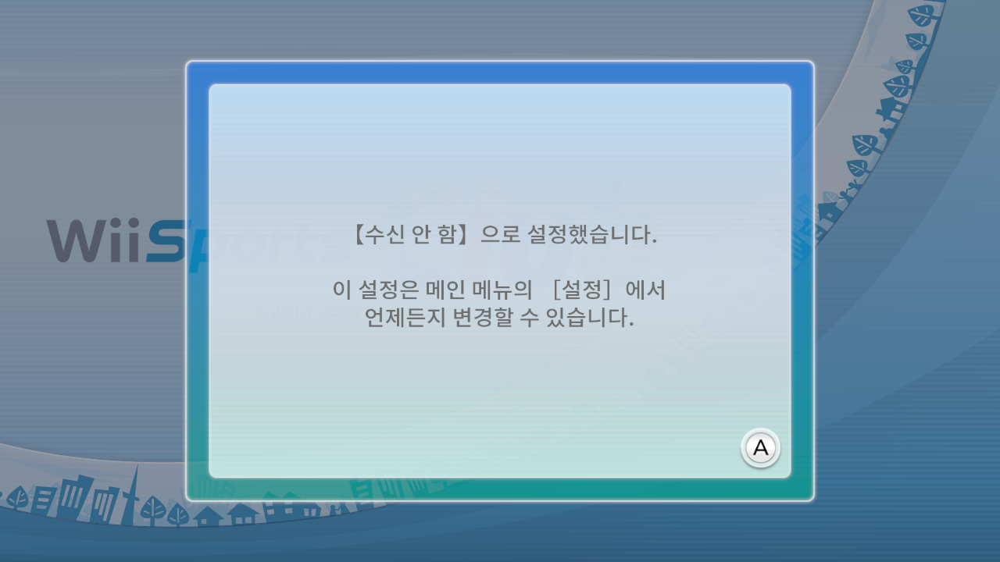

# Wii 스포츠 클럽 한글 패치

일본판 Wii Sports Club(AWSJ01, 타이틀 ID `000500001012F100`) **업데이트 버전 112**를 위한 비공식 팬 한글 패치입니다. 용어와 문체는 Wii 스포츠·Wii 스포츠 리조트 국내판을 따릅니다.

**최신 버전: 1.3.2** · [릴리스 다운로드](https://github.com/auseong325-design/wii-sports-club-korean-patch/releases/latest)

| | |
|---|---|
|  |  |

## 한글화 범위

- 게임 메시지(메뉴, 5종목의 설명·플레이·결과, 클럽·온라인 화면)와 레이아웃 고정 문구, 그림 속 일본어 글자를 한국어로 바꿨습니다.
- 게임 글꼴 5종에 한글을 넣었고, 본체 공유 글꼴을 쓰는 문구(메인 메뉴 종목 이름 등)는 함께 들어 있는 글꼴 플러그인이 한글 글꼴(Noto Sans KR SemiBold 기반)을 넣어 줍니다.
- 그대로 둔 것: 음성, CERO 등급 마크.

## 다운로드

| 파일 | 내용 |
|---|---|
| `WiiSportsClub_Korean_v1.3.2_WiiU.zip` | Wii U 본체용. 설치 앱, 글꼴 플러그인, SDCafiine용 파일, PC FTP 설치 도구, 소스, 라이선스 |
| `WiiSportsClub_Korean_v1.3.2_Cemu.zip` | Cemu 그래픽 팩 |

압축을 푼 뒤 안에 있는 `설치 안내.txt`를 따라 주세요. 게임 원본과 업데이트는 들어 있지 않습니다.

## Wii U 설치 방법

필요한 것: [Aroma](https://wiiu.hacks.guide/)가 설치된 Wii U, SD 카드, 게임 업데이트 버전 112.

**게임을 실행할 때도 SD 카드를 꽂고 Aroma로 켜야 합니다.** 한글 글꼴 플러그인(`wiiu/environments/aroma/plugins/WiiSportsClub_KoreanFont.wps`)이 실행 중에 글꼴을 넣기 때문입니다.

| 방법 | 설명 |
|---|---|
| 1. 전용 설치 앱 | SD 카드에 `wiiu` 폴더를 복사하고 Wii U 메뉴의 「Wii Sports Club KR Patch」를 실행합니다. 원래 파일을 SD 카드에 백업한 뒤 게임 파일을 바꾸고, 같은 앱에서 되돌릴 수 있습니다. |
| 2. SDCafiine | 본체 파일을 바꾸지 않고 SD 카드의 한글 파일을 읽게 합니다. |
| 3. PC FTP 설치 도구 | Windows PC에서 FTPiiU 플러그인을 통해 설치합니다. 원래 파일은 PC에 백업합니다. |

### 이전 버전에서 업데이트

되돌리지 않고 그대로 업데이트할 수 있습니다. 새 패키지의 `wiiu` 폴더 **전체**를 SD 카드에 덮어쓴 뒤 설치 앱에서 「설치하기」를 고르면 바뀐 파일만 새 판으로 바꿉니다. 원래 파일 백업(`wiiu/kopatch/WiiSportsClub/backup`)은 그대로 씁니다. 1.3.2는 글꼴 플러그인만 바뀌었으므로 `wiiu` 폴더를 덮어쓰고 Wii U를 다시 켜면 적용됩니다.

### Tiramisu·구형 CFW

- 설치 앱(`.wuhb`), SDCafiine 플러그인, 글꼴 플러그인(`.wps`), PC FTP 도구(FTPiiU 플러그인 전제)는 모두 **Aroma 전용**입니다.
- 특히 글꼴 플러그인 없이 실행하면 본체 공유 글꼴을 쓰는 문구의 한글이 나오지 않습니다. 그래서 Tiramisu와 구형 CFW는 지원하지 않습니다. Tiramisu는 개발이 끝났고 Aroma로 넘어가는 것을 권장합니다.

## Cemu

`WiiSportsClub_Korean` 폴더를 Cemu의 `graphicPacks`에 넣고 켭니다. Cemu에서는 코드 패치가 Cemu의 한국어 공유 글꼴을 쓰게 하므로 플러그인이 필요 없습니다. 이 게임은 Wii 리모컨 플러스(모션플러스)가 있어야 진행됩니다.

## 스크린샷

설치 앱 6장 (Cemu 모의 실행이라 「테스트 모드」 표시가 있습니다)

| | |
|---|---|
|  |  |
|  |  |
|  |  |

PC FTP 설치 도구 (시험용 FTP 서버에 설치·되돌리기)

게임 화면 (Cemu)

| | |
|---|---|
|  |  |

Cemu에서는 이 다음에 온라인 확인(오류 102-1021)에서 멈춰 메뉴 화면은 찍지 못했습니다.

## 주요 변경 (1.1.0 이후)

- **1.3.2**: 공유 글꼴 자리(메인 메뉴 종목 이름 등)의 한글을 Noto Sans KR Medium에서 SemiBold로 바꿔 Wii 스포츠 국내판처럼 또렷하게 함.
- **1.3.0**: 메시지 75곳, 레이아웃 고정 문구 14곳 수정(골프 「고쳐 쥐기」 등 국내판 표현). 한글 글자의 세로 위치를 글꼴 전체 기준으로 맞춤.
- **1.2.0**: 번역 28곳 수정(「온라인 시합 수」, 「다시하기」, 리모컨 연결 안내 등).
- **설치 앱 1.2.0**: 이전 판 위에 그대로 업데이트할 때 「이전 판 X 설치됨」「X에서 Y로 업데이트」로 표시.

## 구성과 출처

설치 앱, FTP 도구, 글꼴 플러그인의 소스와 라이선스 고지(글꼴은 SIL OFL 1.1)는 Wii U용 ZIP의 `source`, `licenses` 폴더에 있습니다. 비공식 팬 번역이며 Nintendo와 관계없습니다.
